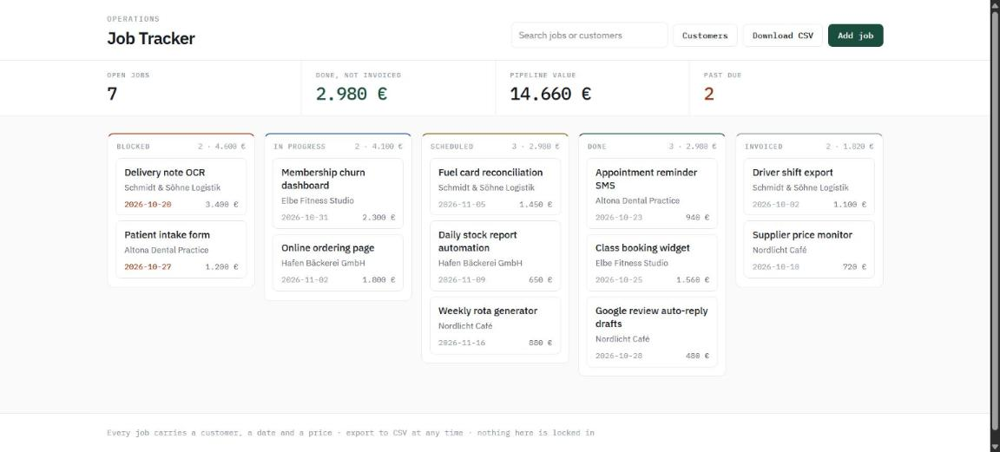
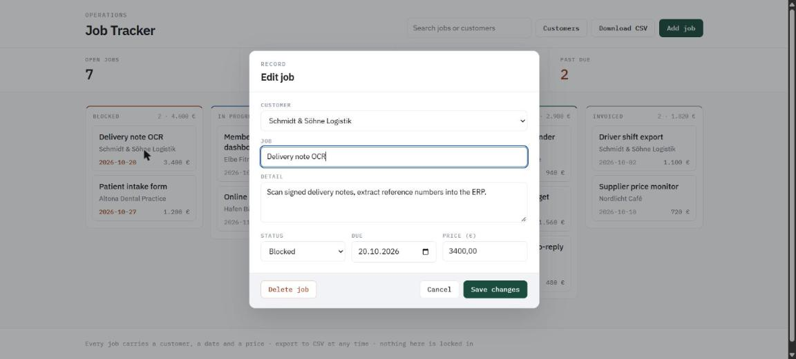
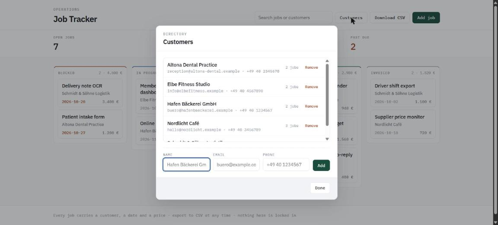

# Service Job Tracker

An internal tool for a small service business: customers, jobs, a status
board, and the two numbers an owner actually checks — what's overdue and what
has been done but not yet billed.







This is the thing that replaces a spreadsheet once the spreadsheet stops
coping: multiple people, a status that means something, and an export so
nobody is locked in.

## Run it

```bash
npm install
npm run build
npm run seed     # 5 demo customers, 12 demo jobs
npm start
```

Then open http://127.0.0.1:3000.

```bash
npm test         # builds, then runs the API suite
```

## Stack

TypeScript, Express, SQLite (`better-sqlite3`), and a dependency-free
front end — plain HTML, CSS and JavaScript. No build step for the UI, no
framework to upgrade in a year. For a tool this size that is a feature: the
client can hire anyone to change it later.

## API

| Method | Route | Purpose |
|---|---|---|
| GET | `/api/customers` | List customers |
| POST | `/api/customers` | Create a customer |
| DELETE | `/api/customers/:id` | Delete a customer and their jobs |
| GET | `/api/jobs?status=&q=` | List jobs, filtered and searched |
| POST | `/api/jobs` | Create a job |
| PATCH | `/api/jobs/:id` | Update a job |
| DELETE | `/api/jobs/:id` | Delete a job |
| GET | `/api/summary` | Counts and values by status, overdue count |
| GET | `/export.csv` | Every job as CSV |
| GET | `/healthz` | Status plus the summary |

Statuses: `scheduled`, `in_progress`, `blocked`, `done`, `invoiced`.

## Design notes

- **Money is integer cents.** `price_minor`, never a float. The CSV and the UI
  format on the way out.
- **Every value is validated before it reaches SQLite.** A non-numeric price
  is `NaN`, which the driver refuses to bind, and a `customer_id` that doesn't
  exist violates a foreign key. Both would surface as a 500; both are caught
  at the route and answered with a 400 that says what's wrong. There is a
  regression test for each.
- **Nothing escapes as an HTML stack trace.** A final error handler turns any
  remaining throw into a logged 500 with a plain JSON body.
- **The update allow-list is explicit.** `PATCH /api/jobs/:id` builds its SQL
  from a fixed tuple of column names and binds every value. Column names are
  never taken from request data; `id` and `created_at` can't be overwritten,
  and there is a test for it.
- **Unknown statuses are rejected at the edge**, so the database can't collect
  typo'd states that silently vanish from the board.
- **Deleting a customer cascades to their jobs** via a foreign key, rather than
  leaving orphan rows nobody can see.
- **`overdueCount` only counts live work.** A job scheduled for last week that
  is already `done` is not overdue, and showing it as overdue is how a
  dashboard loses a client's trust.
- **CSV values containing commas or quotes are escaped**, with a test — the
  German customer names in the seed data are exactly the kind of thing that
  breaks a naive export.

## Configuration

| Variable | Default | Meaning |
|---|---|---|
| `PORT` | `3000` | HTTP port |
| `JOB_TRACKER_DB` | `job_tracker.db` | SQLite file |

## Layout

```
src/types.ts       shared types and the status allow-list
src/db.ts          schema, queries, reporting
src/server.ts      Express routes, validation, CSV export
src/seed.ts        demo dataset
src/api.test.ts    API tests on node:test
public/            the UI: index.html, app.js, styles.css
```

## Verified

Run on 2026-10-29, Node 22.23.4: `npx tsc` clean, `node --test` → 17 passed,
0 failed. Seeded 5 customers and 12 jobs; board, summary tiles, search, the
job dialog, save round-trip, the customers directory (add and delete) and CSV
export all exercised in the browser with no console or server errors.

The two 500-class bugs found in review were confirmed fixed against the
running server: `PATCH` with a non-existent `customer_id` and with a
non-numeric `price_minor` both return 400.
